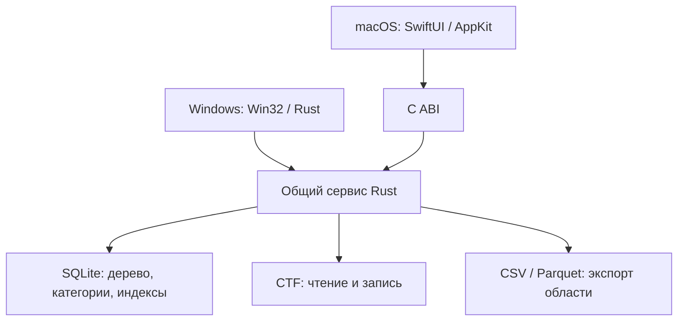

# Архитектура WhereIsIt AI

## Назначение и границы первой версии

WhereIsIt AI — локальный каталог метаданных дисков и папок, предназначенный для Windows и macOS. Файлы после сканирования могут быть недоступны: поиск, навигация и сравнение выполняются по локальной базе SQLite. Приложение не требует постоянного подключения носителей. При сканировании считываются имена, структура, размеры и времена файлов; содержимое файлов и хэши по умолчанию не читаются.

Исходный каталог пользователя относится к наблюдаемому варианту CTF и содержит 44 диска и около 3 046 027 записей. Совместимость с одним исследованным вариантом не означает поддержку каждого варианта CTF. В частности, сжатые варианты, полноценное отображение групп и отображение категорий CTF в собственные категории требуют отдельной реализации и проверки. На предоставленном файле подтверждены прямой reader → writer и полный CTF → SQLite → CTF циклы с побайтовым совпадением. Приём нового/изменённого CTF оригинальной программой является отдельным условием приёмки и не подменяется этой проверкой.

## Слои

1. **`atlas-core`** хранит SQLite-схему, снимки томов и записей, выполняет сканирование, пагинацию, поиск, операции категорий и обновление описаний. Массовый импорт принимает записи по одной и поддерживает одну транзакцию для нескольких томов.
2. **`atlas-service`** объединяет ядро с преобразованием CTF, поиском кандидатов в дубликаты и экспортом выбранного множества. Здесь проверяются операции, формируется согласованный ответ и создаются временные файлы для безопасного экспорта.
3. **`ctf-format`** читает и формирует исследованный вариант CTF; исходные непонятные поля сохраняются как непрозрачные данные там, где это предусмотрено реализацией. Этот модуль отвечает за обменный формат, а не за повседневный поиск.
4. **`atlas-ffi`** предоставляет C ABI для нативного клиента. Запрос и ответ передаются JSON-строками; вызывающая сторона освобождает полученную строку функцией библиотеки. **`atlas-cli`** вызывает общий сервис для консольных операций.
5. **Windows-клиент** написан на Rust с нативными Win32 controls. **macOS-клиент** использует SwiftUI и AppKit и связывается с Rust через C ABI. Оба выполняют длительные операции вне главного потока интерфейса.

Ответы команд имеют вид `{ "ok": true, "data": ... }` либо `{ "ok": false, "error": { "code": ..., "message": ... } }`. Запрос указывает `op` и путь к базе `db`. Клиенты используют идентификаторы записей и томов, а не зависят от доступности исходного диска.



## База и снимки

SQLite встроена в приложение; версия схемы фиксируется через `user_version`. Основные таблицы — `volumes`, `entries`, `categories`, `entry_categories`. Запись содержит имя, относительный путь, тип, размер, необязательное время изменения, описание и теги. Отдельные таблицы CTF хранят исходные атрибуты, DOS-времена и непрозрачные фрагменты. Отношения категорий индексированы. Итоговая схема использует составной индекс `(kind, name_norm, size)` для группировки файлов; он покрывает необходимые поля и уменьшает обращения к полной записи. Два неиспользуемых индекса по полному пути и времени удалены до первого выпуска после проверки реальных SQL-запросов. При завершении массового импорта, внутри той же транзакции, выполняется `PRAGMA optimize=0x10002`: статистика помогает планировщику выбирать индекс расширений для медиафильтров.

Каждое успешное сканирование создаёт новый том-снимок. Старый снимок остаётся доступным при повторном сканировании. Запись снимка выполняется в транзакции: ошибка чтения или своевременная отмена откатывает весь новый снимок. Сканирование не проходит по символическим ссылкам. Отмена, поступившая после начала фиксации, получает ответ `too_late`.

Для импорта нескольких томов предусмотрен `bulk_import_many`: все тома и связанные метаданные фиксируются одним commit. SQLite использует WAL. При крупных транзакциях нужны место под саму базу, временный WAL и резерв свободного пространства; контрольная запись WAL может задерживаться из-за одновременно работающих читателей. Один лишь размер исходного CTF не позволяет надёжно предсказать размер базы.

`total_bytes` тома — сумма размеров логических записей типа `file`. Агрегатные размеры каталогов и контейнеров `archive` в сумму не добавляются, хотя остаются у самих записей. Файлы внутри архивов входят в сумму как логические записи. Это не измерение физически занятого пространства.

## Поиск и категории

Выражения поддерживают `AND`, `OR`, `NOT`, скобки, фразы в кавычках и поля `name`, `path`, `description`, `tag`, `ext`, `size`, `category`. Например:

```text
(ext:pdf OR ext:epub) AND size:>10MiB AND category:"Книги"
```

Текстовые условия по умолчанию ищут подстроку без учёта регистра с использованием Unicode lowercase; `ext` — точное совпадение расширения, `size` поддерживает сравнения и десятичные и двоичные единицы. `*`, `?` и классы символов используют правила SQLite GLOB. Категория, назначенная папке или контейнеру, логически относится и к потомкам в том же томе: например, `category:Music AND ext:flac` находит файлы внутри такой папки. Связи с каждым потомком отдельно не записываются; непосредственное назначение отдельному файлу тоже учитывается. Перечень явно назначенных категорий при экспорте может отличаться от категорий, наследуемых при поиске. Аргументы SQL параметризуются, а число токенов и глубина выражения ограничены. Полного Unicode case folding не заявлено.

Для подходящих подстрок длиной от трёх символов FTS5 trigram с `detail=none` отбирает кандидатов, после чего точное условие перепроверяется по строке. Индексы B-tree обслуживают в том числе расширение, размер, родителей и категории. Очень короткие подстроки и шаблоны без достаточно длинного буквального фрагмента могут потребовать просмотра большого числа строк.

`search` возвращает страницу и точный `total`, что требует подсчёта совпадений. `search_fast` возвращает страницу и `has_more` без полного подсчёта; это уменьшает задержку первых страниц широких запросов, хотя большие смещения и некоторые условия всё равно дороги. В интерфейсе должен отображаться диапазон найденных записей и наличие следующей страницы, а не вымышленное общее число.

## Дубликаты

Режимы «имя и размер», «имя» и «размер» находят **кандидатов по метаданным**. Они не подтверждают равенство содержимого и не запускают чтение файлов. Сравнение по хэшу без ранее вычисленных поддерживаемых хэшей недоступно. Удаление файлов в этот процесс не входит.

Для выбранной конфигурации используется постоянный кэш идентификаторов, групп и порядка. При повторных страницах читается ограниченное число записей; изменение томов, записей и связей категорий меняет ревизию, и кэш перестраивается. Первая группировка и перестройка после изменений используют временное место. На предоставленном каталоге после обновления статистики построение групп для MKV/MP4/AVI заняло около 0,27 с, для MP3/FLAC/M4A — 0,24 с; полная группировка 2,8 млн файлов остаётся заметно дороже. Последующие страницы используют готовые идентификаторы. Точные условия и отдельные прогоны приведены в VALIDATION.md; это не гарантированный SLA для любой машины. Контракт импорта предполагает создание нового тома через публичный массовый API: прямые SQL-вставки записей в существующий том обходят эту модель инвалидации.

## Импорт, экспорт и времена

CTF — формат обмена. Импорт исследованного варианта сначала разбирает источник, затем атомарно сохраняет тома и доступные исходные метаданные. Исходные DOS-времена не содержат часовой пояс: без явно заданного смещения они сохраняются как исходные поля и не превращаются в выдуманное Unix-время. Часть непрозрачных описаний может быть сохранена без декодирования для поиска; диагностика должна раскрывать это ограничение.

CSV и Parquet экспортируют выбранную ветку рекурсивно, результаты запроса или кандидатов в дубликаты. Строки CSV записываются потоком, Parquet — ограниченными пакетами. Экспорт CTF охватывает весь каталог и сейчас собирает структуру и выходные данные в памяти: это не потоковая операция, её расход памяти растёт с размером каталога. CSV/Parquet и CTF выполняют запись через временный файл с последующим перемещением и проверяют защиту работающей базы и существующих файлов. Новые собственные категории и теги блокируют обычный экспорт CTF, пока нет проверенного отображения в его поля; явный `allow_lossy:true` разрешает их пропуск с диагностическими флагами.

CTF содержит особенности и непрозрачные расширения, которые ещё не полностью поняты. Сохранение непрозрачных байтов повышает шансы на совместимость, но не доказывает её. Запрещённые или пока неподдержанные преобразования должны сообщаться явно; результат следует проверять оригинальной программой на отдельной копии.

## Размер и измеренные границы

В предоставленном наборе 44 тома и 3 046 027 записей. Первичный импорт с исходной схемой занял 586,594 с при пике RSS около 809 MiB. После устранения лишних индексов и создания отдельной компактной копии подготовлена база размером 2 161 020 928 байт (около 2,01 GiB); ZIP — 419 970 049 байт. Исходный CTF имеет размер 144 766 574 байта. Рабочая база существенно больше упакованного CTF: в ней повторяются пути и нормализованные поисковые поля, есть B-tree/FTS и обратимые legacy-метаданные. Она не заявляется более компактной.

Поиск первой страницы обычных выражений в измеренном прогоне занимал 5–48 ms по медиане прогретых запросов. Наследуемая категория на ветке из 374 259 записей потребовала около 1,13 с: рекурсивное получение большого множества потомков остаётся отдельным местом для ускорения. Глубокие OFFSET-страницы, короткие подстроки и полный пересчёт дубликатов также могут быть дороже. Метрики относятся к Linux-сборке общего ядра в общей песочнице; нативные ОС требуют собственных измерений.

Следующий этап снижения размера — нормализовать дерево и вычисление путей, сохранив быстрые фильтры по пути и потоковый экспорт. Следующий этап ускорения больших категорий — кэшировать/индексировать замыкание потомков с корректной инвалидацией. Оба изменения требуют версионированной миграции и повторного сравнения результатов, а не только замены SQL.

## Платформы и подтверждённый охват

| Платформа | Текущее подтверждение | До выпуска |
|---|---|---|
| Windows 10+ x64 | Release EXE собраны под Windows x64; запуск, навигация, поиск и кириллица проверены в 64-битном Wine | Проверить актуальную сборку на Windows, включая CTF, диалоги, DPI, доступность и длительные операции |
| macOS 13+ Apple Silicon и Intel | SwiftUI/AppKit-исходники и ABI просмотрены вручную | Собрать с macOS SDK на обеих архитектурах и выполнить нативный smoke test |

Wine не заменяет реальную Windows. Нативный macOS-бинарник и совместимость выходного CTF с оригинальным приложением не подтверждены в этом окружении.
